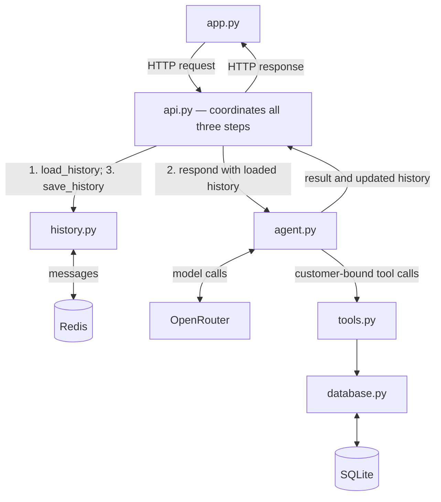
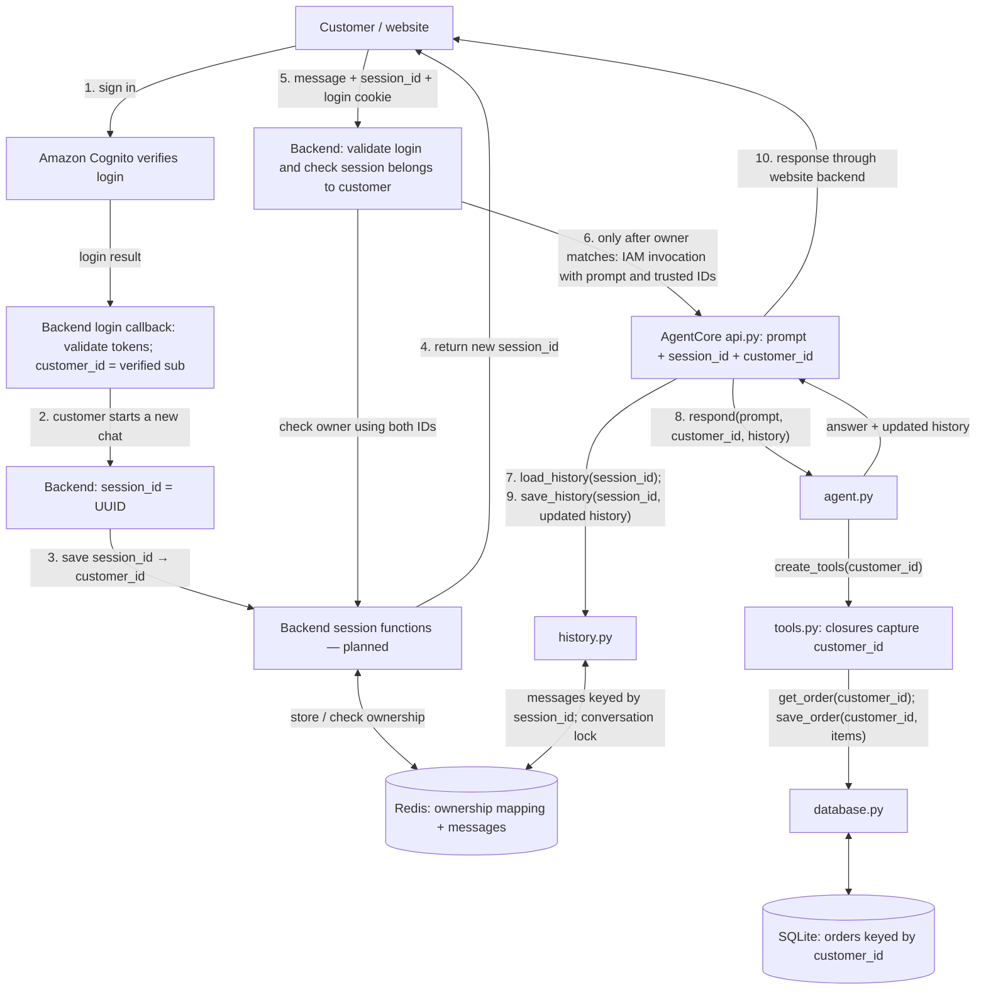

# Kiosk — corrected module calls



**There is no arrow between history.py and agent.py.**

api.py calls history.py to load messages, passes them to agent.py, then calls
history.py to save the updated messages returned by agent.py.

## With Cognito customer authentication — planned flow

This section describes the next integration; Cognito verification and session
ownership are not implemented in the current code.



### Follow the two IDs

```text
session_id:
    Backend creates it → Redis stores its owner → website receives it
    → website sends it with each message → backend checks ownership
    → AgentCore api.py receives it → history.py uses it as the message/lock key

customer_id:
    Backend extracts it from verified Cognito identity
    → backend checks ownership → AgentCore api.py receives trusted identity
    → agent.respond(..., customer_id, ...)
    → create_tools(customer_id) → every tool closure captures it
    → database reads/writes that customer's orders
```

In the earlier session-only version, api.py passed `session_id` into the agent's
`customer_id` argument, so tools captured that same session value. In the planned
authenticated version these are separate: tools capture the verified customer ID;
history.py receives the conversation ID. Tools do not need the conversation ID to
find customer orders. Neither ID is selected by the model.


**Immediately after verified login, when a conversation is created:** the backend
makes a session ID and a backend session function saves
`session_id → customer_id` in Redis.
Every subsequent chat verifies login and checks this existing mapping before
running the agent. Logging in alone does not create a new conversation on every
request. Backend session functions handle ownership. history.py only handles conversation
messages and locks. Both use the same Redis service.


### What is stored where?

**Separate responsibilities:** backend session functions (planned) store/check
ownership. history.py (implemented) loads/saves messages and manages locks.
The backend creates session IDs. Both storage paths use the same Redis service.

The same Redis service can store both ownership and messages under separate keys:

```text
Order database (durable in the planned deployment):
    Orders use verified Cognito sub directly as customer_id (one configured pool).

Redis ownership mapping (planned, saved at conversation creation after login):
    kiosk:session:<session_id> → customer_id

Redis history (already implemented):
    kiosk:history:<session_id> → serialized conversation messages
```

A customer can own several sessions. On every chat/order/reset request, the
backend checks that the authenticated customer owns the requested session.
For a new conversation it generates a session ID and atomically creates its owner
mapping. Missing/expired ownership must not allow an old session to be claimed by
another customer. Ownership and history expiry must be coordinated; Redis locks
protect overlapping turns. The current code implements history and locks only.

### What travels down to the tools?

**The verified customer ID travels down; passwords and AWS credentials do not.**

```text
Login credentials → Cognito only
Cognito token → validated by website backend
Verified Cognito sub → customer_id (no separate identity lookup for this demo)
customer_id → api.py → agent.respond(...) → create_tools(customer_id)
customer_id → database.get_order(...) / database.save_order(...)
```

After login, subsequent website requests must carry a valid application session
or token. The backend resolves the customer from that verified authentication
on every request; it does not trust a customer_id submitted by the browser.

```python
# Proposed website backend flow — these auth/mapping functions are not implemented.
identity = verify_login(token)
customer_id = identity["sub"]
check_session_owner(session_id, customer_id)

# Invoke AgentCore with prompt, session_id and trusted customer identity.
# AgentCore's api.py then coordinates the existing agent/history functions:
history = load_history(session_id)
result = agent.respond(prompt, customer_id, history)
save_history(session_id, result["history"])
```

The model can select order items and quantities. It cannot select another
customer ID: tool closures bind it outside the model's arguments.

### Customer login and AWS authentication are separate

- **Cognito:** establishes which customer is using the website.
- **Backend IAM role:** authorizes the website backend to invoke AgentCore.
- **Runtime execution role:** authorizes the running agent to access AWS resources.

For this design, AgentCore keeps IAM inbound authentication. Only the trusted
website backend may forward customer identity. This needs an explicit forwarding
contract and restricted invocation access; allowing arbitrary IAM callers to
submit a customer_id would let them impersonate customers. Direct notebook
invocation is a separate demo, not a verified customer login.

The customer database shown here must be durable and shared. Current AgentCore
SQLite in /tmp cannot reliably provide cross-session customer identities/orders;
that storage needs changing before this authenticated cloud design is deployed.
