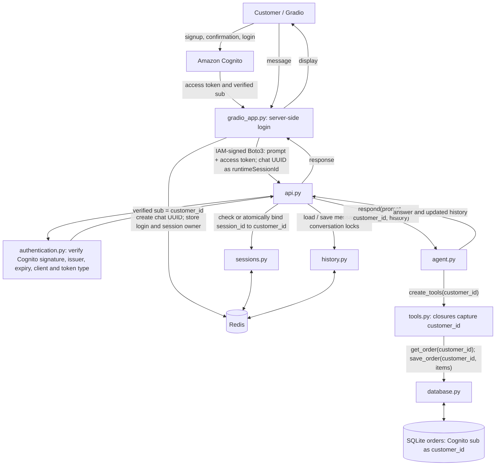

# Kiosk: authenticated customer orders

## Current code (requires redeploying the updated runtime)



There is one history.py node and one Redis service. history.py never calls the
agent. api.py coordinates authentication, ownership, history, the agent and saving.

## The two IDs

| ID | Comes from | Used for |
|---|---|---|
| customer_id | Cognito token's verified sub | Customer's order tools and SQLite rows |
| session_id | Backend-generated UUID | Conversation ownership, message history and AgentCore session |

The browser does not select a customer_id. The runtime verifies the forwarded
access token itself, rather than trusting a submitted customer identity. Passwords
and AWS credentials are never model/tool arguments.

## What Redis stores

```text
kiosk:web:login:<opaque-handle> → {customer_id, access_token}
    Expires with the login token. Gradio State holds the handle server-side.

kiosk:session:<session_id> → customer_id
    Persistent owner mapping; old sessions cannot be reassigned after messages expire.

kiosk:history:<session_id> → serialized LangChain messages
    Expires one day after the last saved turn.

kiosk:lock:<scope> → short-lived lock
    Protects concurrent history/order operations.
```

The frontend registers the chat owner. The runtime checks the same mapping, or
atomically binds a fresh session after verifying its token. Every chat, order and
reset operation verifies customer identity and ownership before accessing data.

## Database boundary

SQLite stores customer_id, product_id and quantity. It does not store passwords.
Existing session-keyed drafts are left unchanged; they are not automatically
assigned to newly authenticated customers.

Correct IDs are not the same as durable cloud storage. On AgentCore, SQLite in
/tmp is temporary and isolated per runtime session. Orders across cloud sessions
still need a shared durable database. Within one database, separate conversations
for the same customer correctly access the same draft.

## Redeploy settings

Rebuild with `python scripts/build_runtime.py`, upload dist/kiosk-runtime.zip and
select Python 3.12 with entry point runtime.py. Runtime configuration needs:
COGNITO_REGION, COGNITO_USER_POOL_ID, COGNITO_CLIENT_ID, REDIS_URL and model variables.
It does not need the Cognito client secret. Do not log access tokens or invocation
request bodies containing them.

Cognito verification is the default. `KIOSK_AUTH_MODE=session_demo` explicitly
restores the old unauthenticated classroom behavior for the original notebook;
it must not be enabled for customer-facing authenticated use.
